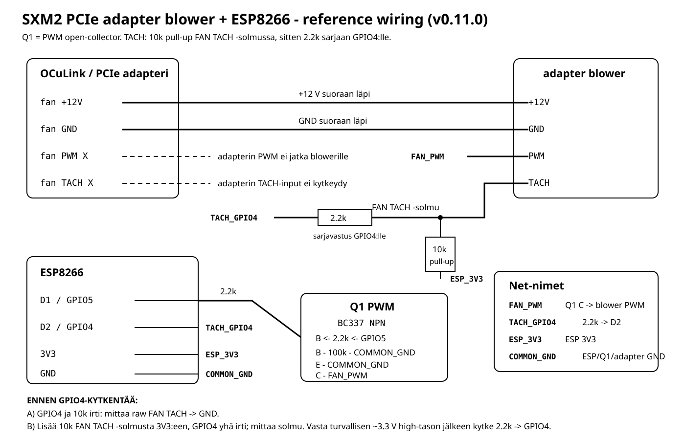

# SXM2 PCIe Fan Controller

ESP8266 + Linux controller for the 12 V 4-wire blower used by an SXM2-to-PCIe adapter/cooling assembly. The reference deployment uses an NVIDIA Tesla V100-SXM2-32GB over OCuLink, but the blower controller is intentionally documented as an adapter/cooling-system component rather than as an on-card V100 fan.

This repository documents the complete working stack used on the reference system:

- SXM2-to-PCIe / OCuLink adapter and its external 12 V 4-wire cooling blower
- NVIDIA Tesla V100-SXM2-32GB as the tested GPU/reference heat source
- ESP8266 NodeMCU / ESP-12E with CP2102 USB serial
- BC337 open-collector PWM stage
- TACH feedback to ESP8266 GPIO4
- Linux Python daemon using `nvidia-smi`
- systemd service
- controller watchdog, stall recovery, host-side stall lock, thermal fail-safe, smoothing, asymmetric rise/fall response, and target deadband

The first public repository snapshot is **v0.11.0**. The ESP serial protocol remains **protocol v3**.

> This is an experimental hardware-control project, not a vendor-supported SXM2/PCIe cooling solution. Verify your own adapter wiring, blower pinout, TACH voltage and GPU thermal limits before using it.

## Architecture

```text
Linux host
  |
  | nvidia-smi: GPU core temperature
  v
Python daemon
  | curve -> deadband -> rise/fall shaping
  | USB serial / SET n
  v
ESP8266
  | 25 kHz PWM through Q1 NPN
  | TACH interrupt / RPM measurement
  v
12 V adapter blower

Power path:
SFX / OCuLink adapter -> blower +12 V and GND
USB host             -> ESP8266 power
All grounds          -> common
```

The host controls only PWM. Blower +12 V and GND remain on the adapter/SFX power path.

See [docs/ARCHITECTURE.md](docs/ARCHITECTURE.md) for the full control pipeline.

## Reference wiring



The normal wiring uses one NPN transistor for PWM:

```text
ESP D1 / GPIO5 -- 2.2k --> Q1 base
Q1 base -------- 100k --> GND
Q1 emitter --------------> GND
Q1 collector ------------> blower PWM

blower TACH -----+-- 2.2k --> ESP D2 / GPIO4
                 |
                10k
                 |
               ESP 3V3
```

Blower +12 V and GND pass directly from the adapter to the blower. Adapter PWM and adapter TACH are not continued to the blower/controller signal path.

The TACH connection is made only after a two-stage voltage check with GPIO4 disconnected. The reference blower behaved as an open-collector/open-drain TACH output; its raw TACH node measured approximately 0.105 V without the added pull-up.

See:

- [docs/WIRING.md](docs/WIRING.md)
- [docs/wiring-simple.svg](docs/wiring-simple.svg)
- [docs/wiring-simple.png](docs/wiring-simple.png)

## Current reference tuning

The repository default config reflects the currently tested reference profile:

```ini
[gpu]
poll_seconds = 8.0
nvidia_smi_timeout_seconds = 2.0
temperature_smoothing_seconds = 5.0
temperature_rise_bypass = true

[fan]
curve = 30:10,55:10,60:15,65:25,70:40,75:60,80:100
minimum_percent = 10
failure_percent = 100
rise_rate_percent_per_second = 100
fall_hold_seconds = 16
fall_rate_percent_per_second = 0.5
target_deadband_percent = 3
deadband_rapid_rise_c = 2
deadband_bypass_temperature_c = 70

[controller]
watchdog_timeout_seconds = 30.0
stall_timeout_seconds = 3.0
stall_recovery_seconds = 5.0
rpm_sample_seconds = 1.0
tach_pulses_per_rev = 2

[safety]
stall_lock_events = 2
critical_temperature_c = 80
```

The reference V100 reported these limits through `nvidia-smi -q -d TEMPERATURE`:

```text
GPU Max Operating Temp     83 C
Memory Max Operating Temp  85 C
GPU Slowdown Temp          87 C
GPU Shutdown Temp          90 C
```

Those values are documented as **reference-unit observations**, not universal constants for every V100 variant. Check your own GPU.

During the observed 170-200 W reference workload, core temperature was usually around 65-68 C, with only occasional 70 C excursions. HBM temperature tracked the core or stayed a few degrees below it. The fan typically operated in roughly the 25-34% range during that workload.

See [docs/TUNING.md](docs/TUNING.md) and [docs/REFERENCE_DEPLOYMENT.md](docs/REFERENCE_DEPLOYMENT.md).

## Fan calibration result on the reference blower

Observed values on the physical blower used for this project:

| Commanded PWM | Observation |
|---:|---|
| 20% | about 2070 RPM |
| 10% | about 1170-1200 RPM once settled; reliable start |
| 9% | about 1110-1140 RPM; reliable start |
| 8% | about 1080-1140 RPM while running; cold start was not consistently reliable |
| 7% | unstable/lumpy behavior, sometimes about 750-870 RPM |
| 6% | stalls and triggers recovery |

The automatic minimum is therefore intentionally **10%**, even though the blower can run at lower commanded values under some conditions.

See [docs/CALIBRATION.md](docs/CALIBRATION.md).

## Safety model

The design has several independent layers:

1. **Electrical PWM fail-safe** - ESP GPIO LOW/off/reset leaves Q1 off, releasing the PWM input; a standard 4-wire fan should run full speed.
2. **ESP serial watchdog** - if host `SET`/`MAX` commands stop, firmware requests 100%.
3. **ESP TACH stall guard** - a non-zero target with no TACH activity forces 100% recovery, then retries the requested target.
4. **Host stall lock** - repeated controller stall events with a live GPU can lock the host target to `failure_percent` until service restart.
5. **GPU-query failure** - `nvidia-smi` failure requests `failure_percent` immediately.
6. **Critical raw temperature** - raw GPU temperature at or above `critical_temperature_c` requests `failure_percent` immediately and logs CRITICAL.
7. **Service stop/restart** - daemon shutdown requests fail-safe speed.

The current reference `critical_temperature_c = 80` is deliberately below the reference GPU's reported 83 C maximum operating temperature.

See [docs/SAFETY.md](docs/SAFETY.md).

## Control behavior

Normal control is intentionally asymmetric:

```text
heating  -> fast reaction
cooling  -> filtered, held, then slow fall
small PWM changes -> deadband may hold current target
rapid heating / high temperature -> upward deadband bypassed
safety event -> all normal shaping bypassed
```

The current 3-point target deadband holds small PWM target changes, but an upward request bypasses the deadband if either:

- raw GPU temperature rises by at least 2 C in one sample, or
- raw GPU temperature is at least 70 C.

All fail-safe requests bypass the deadband and rise/fall shaping.

## Serial protocol v3

```text
HELLO
-> V100FAN 3

CFG 30000 3000 5000 1000 2
-> OK CFG WATCHDOG_MS=30000 STALL_MS=3000 RECOVERY_MS=5000 RPM_MS=1000 PPR=2

SET 28
-> OK TARGET=28 FAN=28 RPM=... WATCHDOG=OK STALL=OK STALLS=0

STATUS
-> STATUS TARGET=28 FAN=28 RPM=... WATCHDOG=OK STALL=OK STALLS=0

CONFIG
-> CONFIG WATCHDOG_MS=30000 STALL_MS=3000 RECOVERY_MS=5000 RPM_MS=1000 PPR=2

MAX
-> OK TARGET=100 FAN=100 RPM=... WATCHDOG=OK STALL=OK STALLS=0
```

Only `SET` and `MAX` feed/re-arm the watchdog. `STATUS`, `CONFIG` and `CFG` do not.

See [docs/PROTOCOL.md](docs/PROTOCOL.md).

## Repository layout

> **Compatibility note:** the public project is named `sxm2-pcie-fan-controller`, but several deployed filenames, service names, install paths and the serial protocol identifier still contain `v100`. They are intentionally retained in v0.11.0 so the documented repository matches the already-tested reference installation and protocol v3. Renaming those identifiers would be a migration, not a cosmetic cleanup.

```text
firmware/v100_fan_controller.ino   ESP8266 firmware

daemon/v100_fan_daemon.py         Linux control daemon
config/config.ini                  documented reference configuration
systemd/v100-fan-controller.service

tools/calibrate_fan.py             running/start PWM calibration
tools/v100fanctl.py                manual serial CLI
tools/list_gpus.sh                 GPU selector helper

tests/test_regressions.py          host-side regression tests
LICENSE                            MIT license

docs/ARCHITECTURE.md
docs/WIRING.md
docs/FIRMWARE.md
docs/HOST_DAEMON.md
docs/CONFIGURATION.md
docs/CALIBRATION.md
docs/TUNING.md
docs/SAFETY.md
docs/PROTOCOL.md
docs/REFERENCE_DEPLOYMENT.md
docs/INSTALL.md
docs/VALIDATION.md
docs/TOOLS.md
docs/TROUBLESHOOTING.md
docs/POWER.md
docs/REFERENCES.md
docs/GITHUB.md
```

## Quick install

First flash the ESP8266 firmware and validate the wiring/TACH voltage according to `docs/WIRING.md`.

On the Linux host:

```bash
sudo apt install python3-venv
python3 tests/test_regressions.py
sudo ./install.sh
sudoedit /etc/v100-fan-controller/config.ini
```

Use a stable serial path when possible:

```text
/dev/serial/by-id/usb-Silicon_Labs_CP2102_USB_to_UART_Bridge_Controller_XXXX-if00-port0
```

Find the GPU selector:

```bash
./tools/list_gpus.sh
```

Check configuration without opening the serial port:

```bash
/opt/v100-fan-controller/venv/bin/python \
  /opt/v100-fan-controller/v100_fan_daemon.py \
  --config /etc/v100-fan-controller/config.ini \
  --check
```

Then start and monitor:

```bash
sudo systemctl start v100-fan-controller
sudo journalctl -u v100-fan-controller -f
```

The installer enables the systemd service but does not start it automatically on the first install.

Full procedure: [docs/INSTALL.md](docs/INSTALL.md).

## Testing

Host regression tests currently cover 13 cases, including:

- delayed duplicate serial replies
- stale `ERR` lines
- old protocol-version detection
- boot banner handling
- legacy stall-lock config fallback
- target deadband behavior
- rapid-rise/high-temperature/force-immediate deadband bypasses

Run:

```bash
python3 tests/test_regressions.py
python3 -m py_compile daemon/v100_fan_daemon.py tools/calibrate_fan.py tools/v100fanctl.py
```

See [docs/VALIDATION.md](docs/VALIDATION.md) for what is software-tested versus physically validated.

## Packaging

```bash
./package.sh
```

The packaging script excludes Python caches and other generated interpreter files.

## Publishing to GitHub

A step-by-step publication checklist is included in [docs/GITHUB.md](docs/GITHUB.md).

This repository is released under the **MIT License**. See [LICENSE](LICENSE). Hardware work remains at the builder's own risk; the software license does not certify an electrical design or a particular adapter/blower combination.

## Scope boundaries

The fan controller does **not** currently:

- control the SFX PSU `PS_ON#` signal
- perform host shutdown on overtemperature
- use HBM temperature as a control input
- use GPU power draw as feed-forward control
- include an external hardware watchdog independent of the ESP8266

Power-on behavior of the OCuLink adapter is documented separately in [docs/POWER.md](docs/POWER.md).
